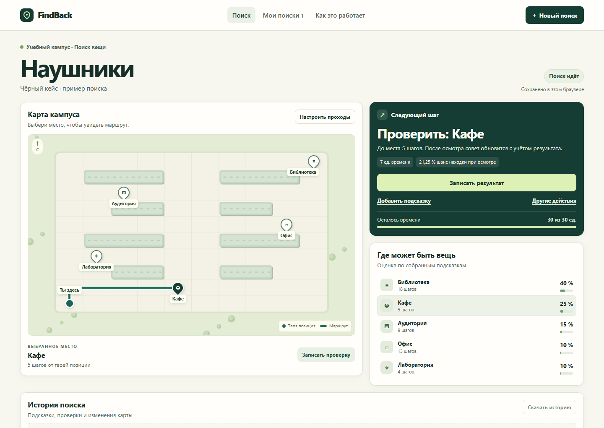

# FindBack

FindBack recommends where to look for a lost item on a fictional campus. It uses Bayesian inference for clues, A* for walking routes, and Bellman planning to choose the next action.

## Quick start

1. [Download the complete project](FindBack_Final_Updated.zip?raw=true) and extract the ZIP.
2. Open the FindBack folder and double-click **Start FindBack.cmd** on Windows. With Python 3.10 or newer, you can also run `python -m findback.webapp --open` from the project folder.
3. Choose **Новый поиск** and enter an item, or choose **Открыть пример** for the demonstration.

[Инструкция на русском](START_HERE_RU.md) · [Colab notebook](FindBack_Demo.ipynb?raw=true) · [Defense walkthrough](docs/DEFENSE.md) · [Experiment results](results/REPORT.md)

